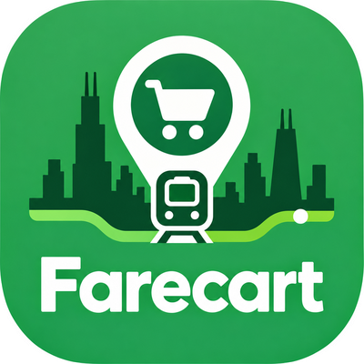

<p align="center"></p>

# Farecart

**Find food. Get there for less.**

Farecart is a native iOS app for Chicagoans who need affordable food and a cheap way to reach it. Enter an address or use your location, see the nearest grocery stores, food pantries and free giveaways on a map, and get CTA directions with the exact fare you'd pay, including the half-price Access fare that SNAP households now qualify for and often don't know about.

Built for Chicago's West Side first, where the last full grocery store closed in July 2026, and now covering all 77 community areas.

<p align="center">
  
  
  
  
</p>
<p align="center">
  
  
  
  
</p>

## What it does

- **Find food nearby.** 860 locations across Chicago: 626 grocery stores that take Link/EBT (from the USDA SNAP retailer list), 190 food pantries and recurring giveaways. Sorted by distance, filtered by type, with hours, phone, what to bring, and store logos.
- **Directions by CTA, in the app.** Real bus and train itineraries drawn on the map with step-by-step instructions, three departure options, and the cost of the trip under CTA's transfer rules.
- **Skip the line.** Pantries post what they have today by category, plenty, low or out, and open visit slots. People book a slot, get a confirmation code, and add it to their calendar. Pantry staff manage stock, slots and arrivals from the same app with a pantry code. No account needed on either side.
- **Know your discount.** Two yes/no questions tell you whether you qualify for the Access reduced fare (SNAP households, $1.10 bus instead of $2.25) or the student fare ($0.75), and how to sign up.
- **For everyone.** Nine languages with instant switching and right-to-left support, light and dark themes, Dynamic Type, VoiceOver labels, and no account required.

## How it works

```
iOS app (SwiftUI, iOS 26)
  ├─ Supabase (Postgres + PostGIS)   nearest-location query, fares, programs, profiles
  ├─ Transitous (MOTIS)              CTA transit routing, free, no key
  ├─ Apple MapKit                    map, geocoding, Apple place cards
  └─ Google favicon service          store logos
```

The app talks to Supabase directly over PostgREST. Fare prices and transfer rules live in the database, so a CTA fare change is a row update, not an app release.

### Trip cost

Cost of a trip equals the fare of the first boarding. Up to two more rides within two hours are free transfers. A fourth boarding, or one outside the window, starts a new fare. Walking-only trips cost nothing, and legs on Pace or Metra are flagged rather than guessed. The rule reads the `fares` table and is unit-tested for every rider type.

## Repository layout

| Path | What's there |
|---|---|
| `ios/` | The app. `Farecart/` is the SwiftUI target, `FarecartKit/` is a Foundation-only Swift package with models, fare math, routing client and tests. |
| `data/` | Location dataset: a hand-researched West Side CSV, citywide CSVs built from USDA, Plentiful, OpenStreetMap and Feed America, demo pantry slots, and the idempotent seed script. |
| `supabase/` | Database schema for places, fares, discount programs, accounts and pantry visits. |
| `api/` | Optional Hono API on Vercel mirroring the app's logic (nearby, geocode, fares, eligibility, transit route) for a future web client. Not required by the app. |
| `docs/` | Screenshots, cover image and [developer notes](docs/DEVELOPER.md). |

## Getting started

### Requirements

- Xcode 26 or newer (iOS 26 SDK, Liquid Glass APIs)
- Node 24 for the data and API scripts
- A Supabase project (free tier is fine)

### Run the app

1. Clone the repo and open `ios/Farecart.xcodeproj`.
2. Put your Supabase URL and publishable key in `ios/Config/Debug.xcconfig`. The publishable key is safe to ship. Never put the service role key anywhere in `ios/`.
3. Choose a simulator or your iPhone, set your signing team, and press Run.

The Swift package tests run without Xcode:

```sh
ios/FarecartKit/test.sh
```

### Set up the database

Create a free Supabase project, run the SQL files in `supabase/` in order, then load the locations:

```sh
cd data && node seed.mjs
```

The seed script reads your Supabase keys from `.env.local` and is safe to run more than once.

### Optional API

```sh
cd api && npm install && npm run dev     # local server
npm test                                  # unit + smoke tests
```

See `api/README.md` for routes and deployment.

## Data and sources

| Source | Used for | License |
|---|---|---|
| Our own research | 44 West Side stores, pantries and giveaways, each with a source link | Project |
| USDA SNAP Retailer Locator | Citywide grocery stores that accept Link/EBT | Public domain |
| Plentiful, foodpantries.org | Food pantry listings and hours | Per site |
| OpenStreetMap | Pantries and store hours | ODbL, © OpenStreetMap contributors |
| Feed America (feedam.org) | Additional pantries and live status where posted | CC BY 4.0 |
| Chicago Transit Authority | Fares and reduced fare programs | Public |
| Northern Illinois Transit Authority | Access reduced fare program | Public |
| Transitous | Transit routing | Community service, no SLA |

No listing is marked verified until a person confirms it by phone or visit. The app says so on every unverified place. Fare prices were checked against the official CTA fares page on October 15, 2026.

## Sign-in

Accounts are optional and only sync discount answers, language and theme between phones. Sign in with Apple and Google both run through Supabase Auth. Setup steps are in `ios/README.md`.

## Roadmap

- Live CTA bus and train arrivals for each step
- Alerts when a pantry adds a giveaway
- Partnerships so real pantries post stock and visit times
- QR scanning for pantry check-in
- Native-speaker review of the seven machine-assisted translations
- In-app account deletion
- Web client on the existing API

## License

Code is released under the MIT License. Data carries the licenses of its sources listed above.
